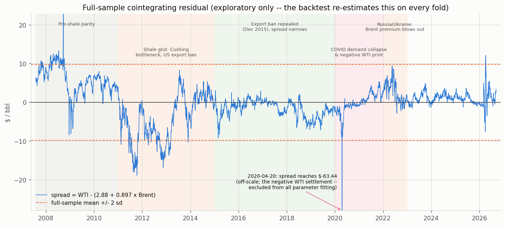
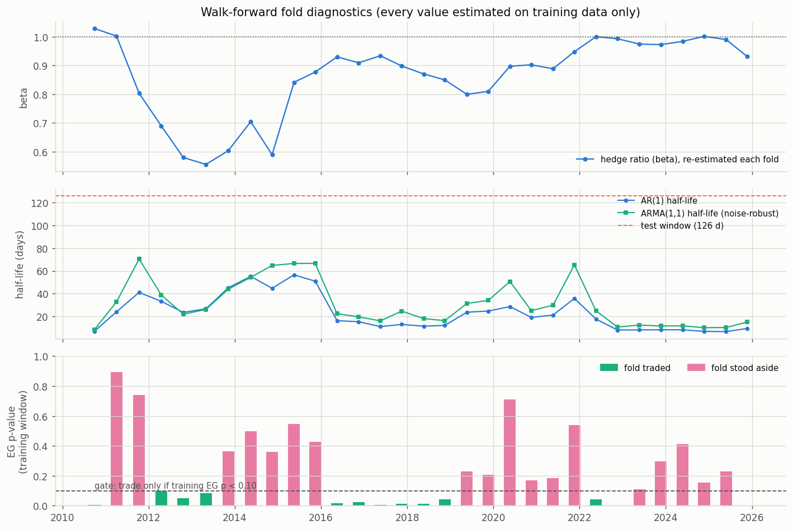
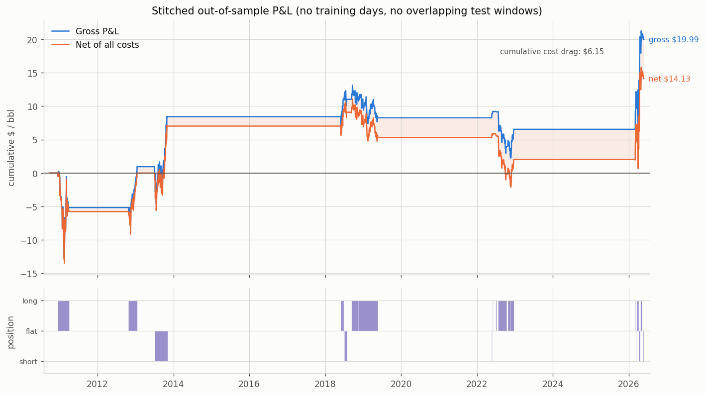
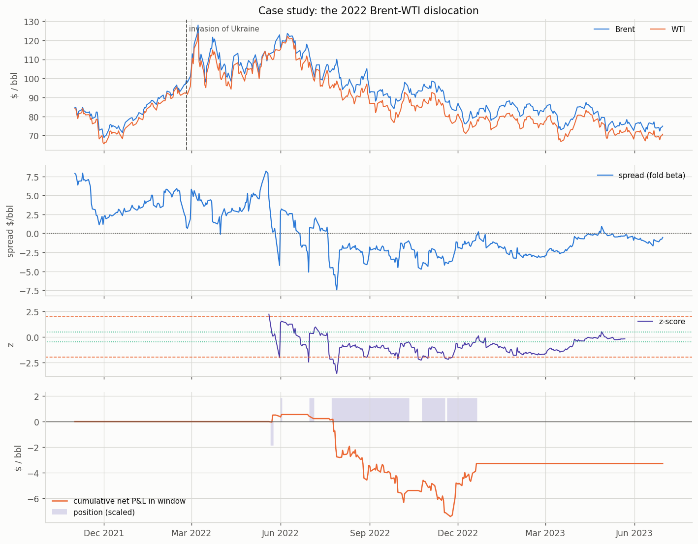

# Brent–WTI cointegration stat-arb

I wanted to know whether the spread between WTI and Brent crude is stable enough
to trade as a mean-reverting pair, once the backtest is done carefully:
walk-forward only, realistic costs, and proper handling of futures rolls.

Short answer: no. The pair is cointegrated over the full sample and the strategy
makes a little money, but the out-of-sample net Sharpe is 0.18 with a 95%
confidence interval of [−0.32, 0.69], it rests on 19 trades, and it falls apart
if I change the training-window length. I don't think there is a reliable edge
here on daily front-month data.

## The idea

WTI and Brent are both light sweet crudes, and they are tied together by
physical arbitrage: pipelines from Cushing to the US Gulf Coast, export terminal
capacity, and tanker freight. If the gap between them gets wider than the cost of
moving a barrel, someone moves the barrel. So each price should wander like a
random walk, but some linear combination of the two should be pulled back to an
equilibrium. That is cointegration, and it suggests trading dislocations in the
spread on the expectation that they mean-revert.

## Data

Daily settlements of the continuous front-month contracts from Yahoo Finance
(`CL=F` for WTI, `BZ=F` for Brent), 2007-07-30 to 2026-09-11, 4,758 days where
both legs printed. Days where either leg is missing are dropped rather than
forward-filled. I work in price levels, not logs, because WTI settled at
−$37.63 on 2020-04-20. That day is kept for marking positions to market but is
excluded from every estimation step.

## Method

**Cointegration test.** I use Engle–Granger: regress WTI on Brent,

$$\text{WTI}_t = \alpha + \beta\,\text{Brent}_t + S_t,$$

and run an ADF test on the residual spread $S_t$. The important detail is the
critical values. Because $\beta$ was estimated to make $S_t$ as stationary as
possible, the residual passes an ordinary ADF test too easily, so the standard
Dickey–Fuller p-values are wrong. I use MacKinnon's critical values for
cointegration residuals instead. On the full sample this matters: the naive ADF
p-value is 0.00007, the MacKinnon one is 0.0069. Both regression directions
reject no-cointegration at 5%, with $\beta = 0.897$ for WTI on Brent.

**Mean reversion.** I model the spread as an Ornstein–Uhlenbeck process and fit
it as its exact discrete-time version, an AR(1):
$S_t = c + \phi S_{t-1} + \varepsilon_t$, with $\theta = -\ln\phi$ and

$$\text{half-life} = \frac{\ln 2}{\theta}.$$

One problem I ran into is that the AR(1) half-life is biased short when the
spread contains transient noise (bid–ask bounce, and the two exchanges not
settling at the same instant). On simulated data with a true 30-day half-life,
adding noise pushed the AR(1) estimate down to under a day. Fitting an ARMA(1,1)
lets the MA term absorb that noise and gives a longer, more honest number. On the
real data the MA coefficient is negative in 29 of 31 training windows, and the
ARMA half-lives are a median 1.38× the AR(1) ones. (Adding more AR lags didn't
help, so I dropped that approach.)

**Walk-forward design.** Each fold trains on 3 years (756 trading days), skips 21
days, then tests on the next 6 months (126 days) with all parameters frozen. The
hedge ratio, OU parameters and z-score mean and standard deviation are
re-estimated in each training window; the entry and exit thresholds (|z| > 2.0 to
enter, |z| < 0.5 to exit) are fixed in advance. That gives 31 folds with an
out-of-sample period from 2010-09-30 to 2026-05-26. The 21-day gap is a
conservative buffer, a bit like assuming some latency between fitting and
trading. It shifts every test window, so changing it changes the sample, but
none of the variants I tried (0 and 42 days) changes the conclusion.

**The cointegration gate.** A fold only trades if its training window shows
cointegration at p < 0.10, a valid OU fit, and a half-life shorter than the test
window. 18 of 31 folds stood aside, including every test window from November
2013 to May 2016, when the shale boom and the US export ban broke the
relationship. Removing the gate turns the Sharpe negative (−0.04) and makes the
maximum drawdown about five times worse (−$67.08 vs −$13.58 per barrel).

**Futures rolls.** A continuous front-month series jumps when the front contract
expires. That jump is a change of instrument, not profit or loss. On days I flag
as roll days, prices move 21% (WTI) and 35% (Brent) more than on other days. I
handle this in two ways: on any day where either leg rolls I book no spread P&L
(but still charge a roll cost), and I freeze the position state so roll jumps
can't trigger entries or exits. If I ignore rolls instead, the net Sharpe goes
from 0.18 to 0.58, P&L from $14 to $66 per barrel, and the hit rate from 53% to
89%. Ignoring rolls would roughly triple the Sharpe, which I think is the most
useful warning in this project.

Costs are $0.05/bbl per leg per side plus $0.05/bbl per leg per roll, about 10×
the quoted half-spread.

As a check on the harness, I deliberately fitted parameters on the test window.
That lifts the Sharpe from 0.18 to 0.67, so the setup does pick up look-ahead
when it is there.

## Results

All out-of-sample, stitched across the test windows (15.5 years, 3,906 days):

| | |
|---|---|
| Trades | 19 (1.2 per year), in the market 14.1% of days |
| Gross / net P&L | +$19.99 / +$14.13 per barrel |
| Net Sharpe | 0.18, 95% CI [−0.32, 0.69] |
| Max drawdown | −$13.58 per barrel |
| Hit rate | 52.6% |
| Net Sharpe, 504-day training window | 0.03 |
| Net Sharpe, 1008-day training window | −0.03 |

The confidence interval includes zero, the maximum drawdown is about the same
size as total net profit, and the result depends on the training-window length.
Only the 3-year window gives the headline number.







**2022.** After Russia invaded Ukraine, Brent (seaborne) priced in the sanctions
risk while WTI (landlocked) could only follow through limited export capacity.
The fold trained up to April 2022 still looked cointegrated (p = 0.042), so it
traded, and a long position opened on 2022-07-25 was held for 56 days and lost
$5.52, more than the whole year's net loss of $3.28. The equilibrium itself had moved, and a
3-year training window with only two months of post-invasion data couldn't see
that.



## Limitations

1. **The Brent roll calendar is wrong before 2016.** The code uses the current
   ICE expiry rule (last business day of the second month before delivery) for
   the whole sample. Before 2016 Brent expired on the business day before the
   15th calendar day before the first day of the delivery month, so pre-2016 Brent roll days are
   misdated. I haven't yet re-run the study with the corrected calendar.
2. **One trade drives most of the P&L.** The short spread trade from 2026-04-07
   to 2026-04-17 made $10.40 net, against $14.13 for the whole 15.5 years. In
   that period, during extreme backwardation, the front-month WTI and Brent
   contracts referred to different delivery months, so this is not a clean
   spread trade.
3. **The data isn't tradeable.** Continuous front-month Yahoo series are not
   contracts you can hold. Both the roll handling and the negative price print
   are artefacts of that.
4. **Small sample.** 19 trades is not much to infer from, however many days sit
   underneath.

## Next steps

- Use contract-level data and pair WTI and Brent by delivery month.
- Let the hedge ratio adapt over time (Kalman filter or EWMA) instead of fixing
  it per fold.
- Test for structural breaks: Chow tests at known dates (such as the 2022
  invasion) and Bai–Perron for unknown ones.
- Add a time stop so a position can't sit for months after the equilibrium has
  moved.
- Add a fundamental gate (e.g. Cushing inventories, export capacity, freight).

## How to run

```bash
pip install -r requirements.txt
python run_analysis.py                 # full study (~35 min)
python run_analysis.py --quick         # fewer Monte Carlo reps
python run_analysis.py --refresh-data  # re-download from Yahoo
```

Prices are cached in `data/cache/` after the first run. Results go to
`outputs/` (figures, CSV tables, `results.json` and `run_log.txt`).
